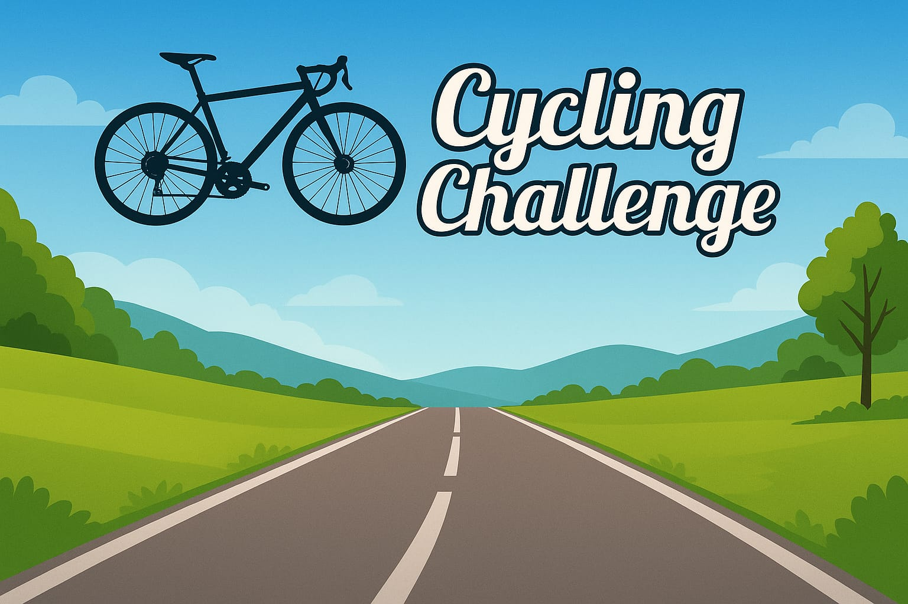
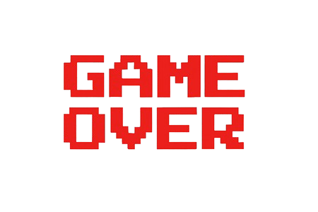
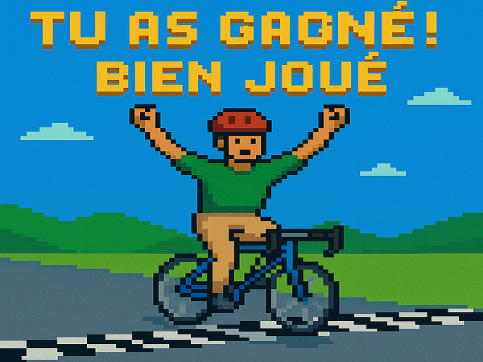
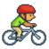
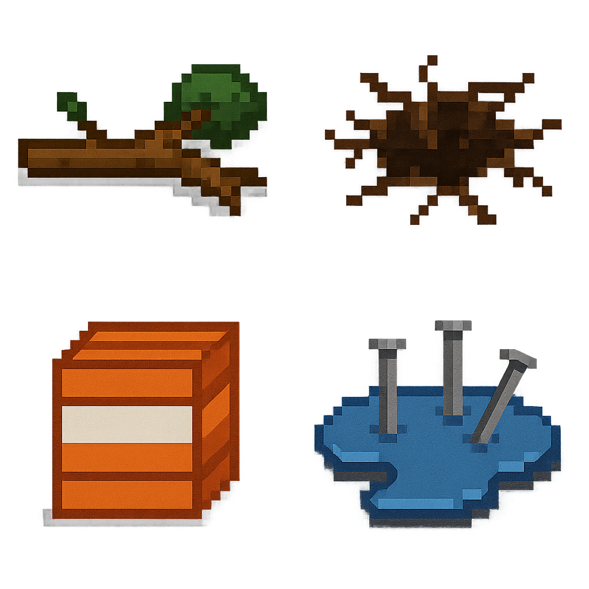
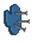
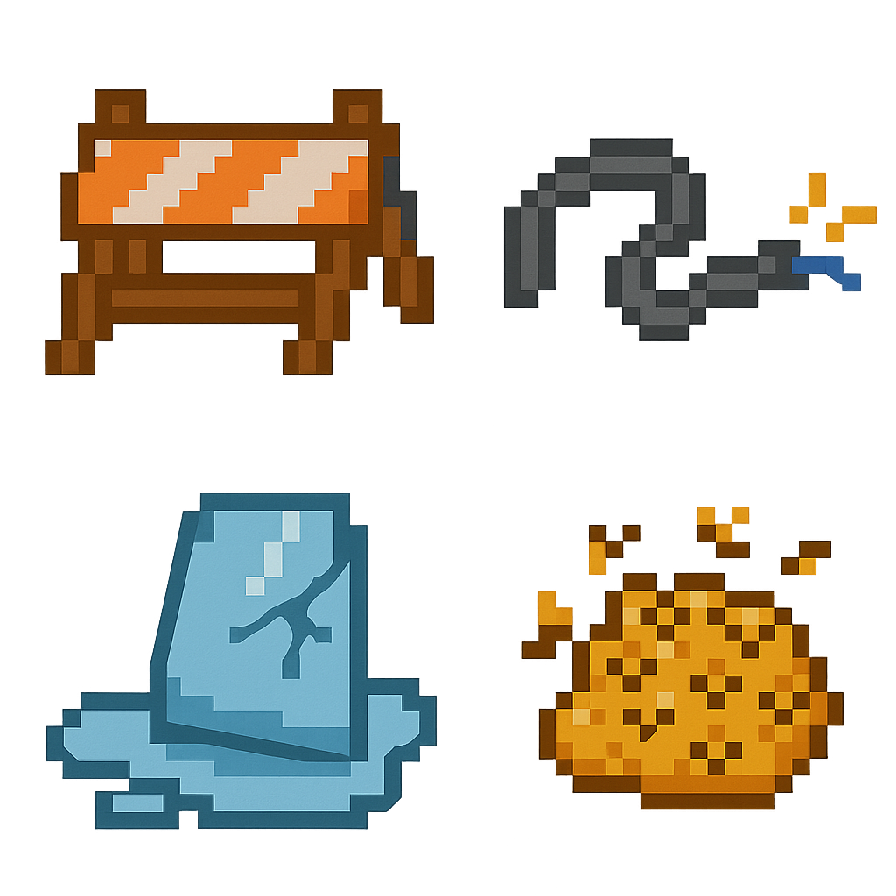
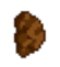

# 🚴 VeloGame

A 2D bike racing game written in **C++** with **SDL2**. Race against the clock, dodge the obstacles on the track and reach the finish line before the 60-second timer runs out.

Made as an object-oriented programming mini-project at the Faculté des Sciences Semlalia de Marrakech (FSSM), Computer Science department, 2024-2025.

<p align="center">
  
</p>

## Gameplay

- Ride a bike on a multi-lane track with a scrolling background.
- Obstacles spawn at random and get faster as time goes on. Hitting one slows you down.
- A visual countdown runs from **60 to 0**. When it reaches 0, it's game over.
- Your distance is shown live (`Distance: xxx m / 3500 m`). Reach the goal before time runs out to win.
- Music and sound effects, with volume and mute buttons.

| Game over | Victory |
|:---:|:---:|
|  |  |

### Sprites

| Player | Obstacles |
|:---:|:---:|
|  |     |

## Controls

| Key | Action |
|---|---|
| `→` (Right) | Start the race from the start screen |
| `↑` / `↓` | Change lane |
| `←` (Left) | Brake (you accelerate automatically otherwise) |
| `P` / `Esc` | Pause menu (Continue / Quit) |
| `Enter` | Confirm in menus |
| `R` | Restart after game over or a win |
| `Esc` | Back to the main menu from the end screens |

## Run the game (Windows)

1. Make sure these files are in the same folder: `GameEngine_2D.exe`, `SDL2.dll`, `SDL2_image.dll`, `SDL2_mixer.dll`, `SDL2_ttf.dll` and the `assets/` folder.
2. Run `GameEngine_2D.exe` from that folder (the game loads `assets/...` using relative paths).

## Build from source

**Requirements**

- A MinGW-w64 (64-bit) C++ compiler
- SDL2, SDL2_image, SDL2_mixer and **SDL2_ttf** (the 2.x development packages for MinGW). Don't use SDL3 versions.

**Code::Blocks**: open `GameEngine_2D.cbp`, fix the library paths in *Project → Build options* if yours are not under `C:/Dev/...`, then build and run.

**Command line (MinGW)**

```bash
g++ -g -Isrc/Obstacles main.cpp src/*/*.cpp -o GameEngine_2D.exe \
    -lmingw32 -lSDL2main -lSDL2 -lSDL2_image -lSDL2_ttf -lSDL2_mixer
```

Add `-I` / `-L` flags for your SDL install folders if needed, and copy the SDL DLLs next to the exe.

## Project structure

```
VeloGame/
├── main.cpp
├── GameEngine_2D.cbp        # Code::Blocks project
├── assets/                  # images, menu buttons, countdown frames, fonts, audio
└── src/
    ├── Core/                # Engine: game loop, states, rendering, collisions
    ├── Objects/             # Player (movement, lanes, speed)
    ├── Obstacles/           # Obstacle data
    ├── Graphics/            # TextureManager
    ├── Audio/               # AudioManager (music and effects)
    └── Menu/                # Main menu
```

## Authors

- Doubabi Ali
- Saloumy Meriem

Supervised by Prof. R. Hannane. A full report (in French) is in [`rapport_jeu_course_velo.pdf`](rapport_jeu_course_velo.pdf).
